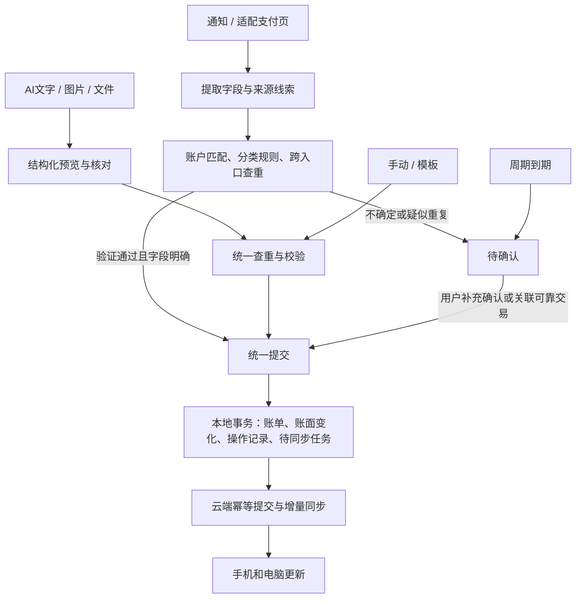

# 见财：自动收支记账产品设计基线

日期：2026-10-30。状态：根据用户逐项选择及“ok 先按照这一版”定稿。这里的“首版”是完整交付范围，分阶段实现不代表删减功能。本文不表示代码已完成或设备测试已通过。

决策原始记录：[逐项核对表](2026-10-29-yimu-redesign-review.md)。实施顺序：[交付计划](../plans/2026-10-30-auto-bookkeeping-delivery.md)。竞品依据为用户提供的一木 6.7.0 静态分析、设计提炼及尚未执行的真机清单；借鉴概念与测试，不直接引入反编译源码、资源或私有服务。

## 1. 产品目标与成功标准

为本人在一加 13 和电脑使用的一个日常账本，自动记录收支、减少漏记与重复；网页和 App 能查看、补记、修改和删除同一份账。重点是记账和纠错，不提供股票、证券、收益或资产增长看板。

成功标准：

- 经验证的规则，在金额、方向、交易时间、实际资金账户明确且不存在重复冲突时自动入账；只识别到一级分类不阻碍入账。
- 不确定记录说明原因并集中核对；它们不计入正式统计，不改变账面余额。
- 手机离线可记账；联网前台以秒级跨端更新为目标，实际延迟和后台限制在一加上测量，不承诺任何时刻即时。
- 新增、修改、删除、恢复、退款及重试均保持账单、已启用余额和统计一致；网络重试不能重复记账。
- 用户能从汇总数字找到原始流水，知道来源、发生日期、修改记录和同步状态。
- 自动识别覆盖按应用版本和交易场景给出实测结果，不用白名单数量代替覆盖率。

## 2. 信息结构与页面

手机底部固定三个入口：**账单 / 统计 / 我的**。电脑沿用相同名称，使用更宽的列表和筛选区。账户是资金来源与去向，放在“我的→账户”，也能从账单账户字段进入；不设资产总览主导航。

### 账单

- 顶部：月份、当月收入、原始支出、退款、净支出及结余。主视觉突出净支出与结余，其余数字可展开，避免六个同权重的大卡片。
- 待处理入口：显示数量，点开待确认列表。待确认详情分别解释缺账户、日期待核对、金额歧义、疑似重复或周期到期。
- 流水按发生日期分组；每行显示商户/摘要、分类、金额、账户及必要状态。退款、转账明确标记，不能用收支正负号掩盖类型。
- “记一笔”打开金额优先表单；文字/输入法语音、图片、模板、文件导入作为入口，统一进入同一账单处理逻辑。
- 筛选支持日期、分类及子分类、账户、标签、商户、来源。日历首版不独立占导航。
- 账单详情有修改、删除、查看来源和关联记录入口；录入时间、修改时间、同步信息可展开。
- 回收站保留 30 天供恢复；到期清理可恢复内容，但同步删除标记独立保留，旧设备不能使账单复活。

### 统计

- 按月份/日期范围汇总，分类排行与时间趋势可以进入对应账单列表。
- 转账、还款、待确认、已删除及被排除统计的记录不混入普通收入/消费。
- 默认以一级分类汇总，可展开子分类；标签用于跨分类查看旅行等开销。
- 可选月度总预算：未设置不占首页。展示已用、剩余或超额，退款冲减到账月预算，不重写过去预算。
- 月度结余是收入减净支出，不是账户余额，也不称为可自由支配金额。

### 我的

- 账户：实际资金账户及可选账面余额；未设置余额显示“未设置”，不能补成零。信用卡启用余额后显示账面欠款。
- 账户详情：账单与余额变动明细，消费、转账、编辑、删除、恢复、校正均可解释。
- 分类和标签管理：一级/二级分类、排序、停用；历史分类不直接删除。标签可多选且不强制填写。
- 商户分类规则、账户线索映射：可查看、修改；分类修正询问是否记住，默认不改历史账。
- 模板、周期规则、月度总预算、回收站、导出备份。
- 自动采集：每个应用的适配状态、权限状态、服务连接状态和最近识别记录。未看到事件不能称为“没有消费”。
- 同步：待上传条数、最后成功时间、失败原因和重试入口。区分本机保存与云端确认。
- 浅色/深色模式，固定导航；首版不做复杂皮肤或布局定制。

所有页面具备加载、正常、空和失败状态；表单重复提交受控，失败保留输入。重要操作有反馈，长文本可完整查看；手机大字体、横屏、电脑与键盘操作纳入验证。

## 3. 录入流程

手动和模板点保存后不再重复确认。AI、图片、文件先展示结构化结果；周期到期不是付款凭据，不直接变更余额。

### 自动采集与九个应用

首批范围为微信、支付宝、招商银行、掌上生活、云闪付、淘宝、京东、拼多多、美团。通知和可选无障碍互补，可以只开启一种。每个适配器记录已验证版本、页面/通知类型及不支持场景；未知结构保留待核对或不识别，不能冒充已适配。

只处理用户启用来源中的交易信息。无障碍只读适配支付页面，不读取聊天、验证码或密码，不点击、不支付、不持续截图。不开启服务仍能使用手动和导入。

来源应用不等于实际资金账户。例如微信绑定招商卡付款，资金账户是招商卡。银行和卡尾号等可靠线索经首次确认后形成映射；线索不足或多个账户匹配时待确认。

同笔交易的多个来源关联一个账单。优先使用来源范围内的交易标识及可验证关联；不同平台的相同字符串编号不能直接认定同一交易。只有金额/时间近似时不自动合并。来源关联可纠正，忽略或删除过的来源不得直接再次生成同一笔账。

自动规则先以样本验证，再开放直接入账。识别和分类规则的版本改变不能静默重写历史账单。原文和样本默认不上传或长期保存，仅保留解释来源所需的结构化字段及标识摘要。

### 文字、图片、导入、模板与周期

- 文字：首版接 AI，输入法语音可生成文字；不单独录音。只发送本次文字、日期参考、必要分类及账户别名，不附带历史流水、余额、完整卡号。识别到意外敏感字段时先处理或要求核对，不把授权理解为上传整个账本。
- 图片：系统选择器主动选择图片，本机 OCR 加本机解析优先；用户主动选择时才上传本次图片补充识别，不暗中把 OCR 文字发云端。结果核对后保存，不保存为账单附件。
- 文件：保留微信、支付宝、招商和通用 CSV/XLSX。先预览和使用已确认映射，未匹配项目由用户选择/主动新建，不能静默批量建分类或账户。原有真实格式边界继续如实显示。
- 模板：用户主动打开，预填分类、账户、备注等，核对后保存；仍参与查重。
- 周期：规则与记录分离，同一期只生成一次待确认项；设备关闭后补跑，按上海时区。可靠实际付款证据到来时关联周期项，避免两笔入账。

## 4. 账单与金额规则

对象分开：一个账本、多个账户、父子分类、可选多个标签、账单、来源证据、商户规则、账户映射、模板、周期规则、预算、余额历史、同步操作及删除标记。

正式账单至少包含稳定标识、版本、类型、交易时间、录入/修改时间、金额（整数分）、CNY、资金账户、分类、商户、备注、标签、来源关联、排除统计/预算开关及必要的原账关联。同步状态独立于“待确认/已入账/已删除”，不能用一个枚举混淆两类状态。

金额计算采用整数分，校验跨端可精确处理的范围；不能使用浮点金额加减。输入/识别/导入超过两位小数时先核对。HTTP 既有数字范围与 Android Long、数据库 bigint 的差异由同一范围校验约束，不因存储可容纳更多位就默许网页失真。

| 操作 | 账面余额 | 正式统计 |
|---|---|---|
| 收入/支出 | 启用余额的账户加/减金额 | 分别计收入/支出 |
| 账户转账/信用卡还款 | 转出减、转入加 | 不计普通收支 |
| 手续费 | 扣实际承担账户 | 单独计支出，关联转账 |
| 部分/全部退款 | 实际到账账户增加退款 | 关联原消费，到账月显示退款，冲减净支出 |
| 修改 | 撤销旧影响、应用新影响 | 同步重新计算，不重复累计 |
| 删除/恢复 | 撤销/重新应用一次实际影响 | 退出/重新加入统计 |
| 不计统计/预算 | 实际余额变化不受开关影响 | 分别排除对应口径 |
| 待确认 | 无变化 | 不计入 |

退款累计不能超过关联原支出；原账有退款关联时不能静默删除或修改到不一致状态，需先明确处理关联记录。跨月退款不把原消费搬到本月，也不伪装成工资等收入。统计需要分开提供原始支出、退款和净支出；分类退款归属于关联原消费分类。

余额为可选账面值。已有账户余额迁移时保留原值；新账户未填初始余额保持未知。启用/校正余额时记录基准和调整原因，不凭当前流水倒推出银行余额。导入历史账单默认保留现有余额，保存该批记录的余额影响模式；以后编辑或删除必须撤销实际应用过的影响，而非假设每条流水曾扣款。启用余额不能把全部旧流水再次累计进去。

## 5. 保存与同步

手机先在 SQLite 同一事务中写入业务变化、历史与持久队列；服务器在 PostgreSQL 同一事务中校验版本、更新余额、记录结果和变更序列。两者不是一笔跨网络事务；联网失败显示待同步，不能回报云端成功。

每次逻辑操作有稳定 ID，重试使用相同内容；响应丢失先重试确认原结果，不能改变请求内容或新建 ID。连续两笔真实同额交易使用不同 ID。后台任务只负责同步，不代替通知和无障碍实时采集。

服务端按实体版本判断更新冲突；出现冲突保留两端候选，让用户选择，不以客户端时间决定覆盖。列表的业务发生时间与同步游标无关，补录旧日期也必须出现在新增变更中。同步分页只能在对应页面成功落盘后推进游标。

删除内容进入 30 天回收站；到期后继续保留不含完整账单内容的删除标记/版本控制，拒绝旧设备的陈旧上传。清理回收站不依赖付费定时任务：可在相关请求中执行到期检查并使到期记录不可恢复。

原网页 Cookie 鉴权、来源校验和服务器密钥边界保留。App 的持久登录凭据需设备安全存储，过期后重新登录；不能为同步关闭原有校验，也不能把服务端密钥放进 App。若实际实施必须调整鉴权连接配置，先按项目规则说明影响范围。

完整备份独立于同步。首版支持主动下载并在隔离环境验证恢复；备份包含当前支持的数据及必要关联，不包含登录凭据。正式恢复前预览、保留当前状态并协调同步，不能让旧云数据覆盖恢复结果。CSV 只用于查看和迁移，不承诺完整恢复。

## 6. 技术复用与已知起点

| 部分 | 当前可复核复用 | 新版必须补齐 |
|---|---|---|
| Web | React/Vite、金额/日期处理、CSV/XLSX 解析与预览、登录 | 三导航、完整账单编辑/删除/退款/标签/层级分类、状态显示与增量刷新 |
| 服务端 | Vercel Node Functions、PostgreSQL、事务、持久请求幂等 | 可选余额、稳定 ID 与版本、来源关联、账务操作、同步变化、完整备份 |
| Android | Kotlin/Compose/Room 试验代码、受限采集策略及解析测试源码 | 可重现构建、正式持久队列、账户等主数据同步、九应用适配、三导航与完整纠错 |
| 测试 | PGlite 合成账本、网页集成脚本、解析用例 | 版本冲突/删除/退款/恢复/跨入口去重；Android JVM/界面测试与一加真机 |

当前服务端只有列表、新增和导入等接口，不能称为已经有完整账单修改或同步。Android 仍是未完整验证的试验工程；不能将现有几条支付窗口白名单说成九应用覆盖。旧试验计划仅供参考，以本基线为准。

## 7. 首版之外与仅剩参数

明确不纳入首版：股票投资、多账本切换、共享成员、报销、多账户拆单、外币汇率、分类预算、图片附件保存、定位、独立录音/相机/悬浮窗、自动云备份/WebDAV、外部 Scheme/快捷指令、MCP 查询/写入/监听、广告社交 SDK、复杂皮肤、额外生物识别应用锁或数据库加密层。

AI 两个实际参数尚未确定：**服务商/模型与月度费用上限**。可以先完成接口、保留输入和不可用状态；选定前不做真实付费调用。具体供应商还需核实图片能力、计费、留存和调用限制。文字和云端图片的隐私范围沿用已确认选择，不默认扩大。

## 8. 验收与交付门槛

- D01–D08、D12 必须执行：拒绝权限、账务一致性、转账/退款/统计口径、断网和重复、AI 歧义、真机采集与图片、完整恢复。
- D09–D11 对应本版不做的外部链接/MCP，标“不适用”，不能写“通过”。D04 中报销用例同理。
- 合成账本：现金 1000 元、银行卡 2000 元；现金支出25后975，改30后970，再改银行卡则现金1000、卡1970；删除恢复各应用一次。
- 同额两次消费不得误合并，同一消费多来源不得重复入账；退款、跨月与重复导入同时检查账单、余额、预算和统计。
- 先独立测试数据库/本机验证，再一加 13；用户下载 APK 安装，实际权限由手机端开启。线上切换前验证迁移与回滚，既有真实数据不用于破坏性测试。
- 每阶段给出实际构建/测试结果和未验证边界；完整首版必须通过全部适用门槛，不能用某一阶段完成代替全部完成。
